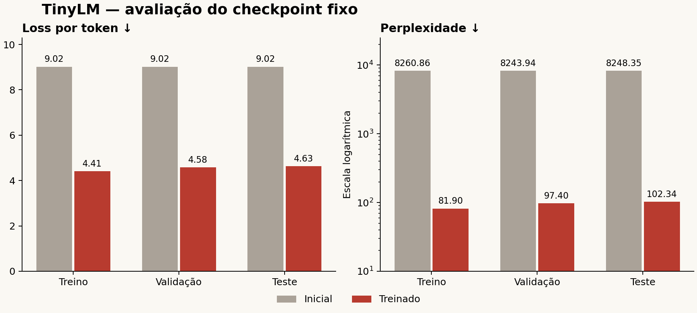

# 7.03.5 — Geração e avaliação do TinyLM

Checkpoint da época 8, selecionado previamente por validação. Pesos e teste preservados.

## Método principal: janelas de documento de até 256 tokens

| Partição | Loss inicial | Loss treinada | PPL inicial | PPL treinada | Alvos |
| --- | ---: | ---: | ---: | ---: | ---: |
| Treino | 9.0193 | 4.4055 | 8260.86 | 81.90 | 2953717 |
| Validação | 9.0172 | 4.5789 | 8243.94 | 97.40 | 21588 |
| Teste | 9.0178 | 4.6283 | 8248.35 | 102.34 | 14880 |

PPL = exp(loss média ponderada por alvos válidos). Logits originais, float32, sem filtros de geração.
EOS é avaliado; BOS e padding não são alvos. Mesmo BPE e protocolo para os dois checkpoints.
A perplexidade não mede veracidade nem qualidade clínica. A loss não é porcentagem de acertos.

## Contexto sobreposto: stride 128, medido separadamente

| Partição | Loss inicial | Loss treinada | PPL inicial | PPL treinada |
| --- | ---: | ---: | ---: | ---: |
| Validação | 9.0207 | 4.5665 | 8272.46 | 96.21 |
| Teste | 9.0182 | 4.6107 | 8252.13 | 100.55 |

O método sobreposto reutiliza somente contexto, sem contar alvos duas vezes. As medidas são identificadas separadamente; não substituem a medida principal.

## Geração exploratória — todas as estratégias predefinidas

| Estratégia | Amostras | Tokens médios | Paradas EOS | Limite atingido | Bigramas repetidos (média) | U+FFFD |
| --- | ---: | ---: | ---: | ---: | ---: | ---: |
| greedy | 8 | 58.1 | 1 | 7 | 68.0% | 0 |
| nucleus_p09 | 24 | 40.6 | 15 | 9 | 0.2% | 0 |
| sample_t07 | 24 | 39.8 | 16 | 8 | 4.0% | 0 |
| sample_t1 | 24 | 41.0 | 15 | 9 | 0.2% | 0 |
| sample_t13 | 24 | 51.6 | 9 | 15 | 0.0% | 3 |
| topk_50 | 24 | 44.8 | 12 | 12 | 0.6% | 0 |

Total: 128 amostras, até 64 tokens cada, 8 prompts próprios e 3 sementes nas estratégias aleatórias. Greedy usa uma semente porque não sorteia tokens.
Bigramas são pares de palavras da continuação. Repetição e diversidade são diagnósticos descritivos, não notas de qualidade.
As saídas integrais estão em `private/generations.jsonl`. Não foram selecionadas apenas as melhores gerações.

## Leitura qualitativa

Leitura integral das 24 continuacoes predefinidas no protocolo: 8 prompts x greedy/sample_t1/nucleus_p09, semente 42. Coerencia: 0 = nao sustenta uma ideia consistente ou e dominada por loop; 1 = ideia local inteligivel com falhas importantes; 2 = continuacao sustentada e pertinente. Estas notas nao avaliam veracidade ou seguranca clinica.

- Nenhuma das 24 continuacoes revisadas sustentou uma ideia coerente no criterio adotado; apareceram fragmentos reconheciveis de portugues, mas tambem palavras deformadas, concordancia ruim e mudancas de assunto.
- Greedy apresentou forte repeticao: media de 68,0% dos pares de palavras repetidos nas 8 amostras. Sete atingiram o limite de tokens e uma terminou por EOS.
- Sample_t1 e nucleus_p09 tiveram pouca repeticao de bigramas, mas isso nao se traduziu em coerencia ou pertinencia nas 16 amostras dessas duas estrategias revisadas.
- As 12 continuacoes revisadas dos prompts de pergunta, alteracao de agenda, desconforto e disponibilidade de treino nao produziram resposta util ao pedido.
- Os textos imitaram trechos de verbetes, listas, referencias e nomes/datas sem verificacao factual. Uma aparencia de fonte ou data nao demonstra que a informacao esteja correta.
- A estrategia sample_t13 produziu tres caracteres Unicode de substituicao no conjunto de 24 amostras; as demais estrategias nao produziram esses caracteres. O decoder de bytes pode encontrar sequencias invalidas ou terminar no meio de um caractere ao atingir o limite.
- Nos maiores erros de proximo token aparecem trechos tecnicos, nomes e continuacoes de subpalavras; o modelo frequentemente preferiu pontuacao ou partes comuns de palavras. O relatorio de erros guarda somente predicoes diferentes do alvo, com contexto e atribuicao locais.

| Prompt | Estratégia | Coerência (0–2) | Responde ao pedido | Observação |
| --- | --- | ---: | --- | --- |
| p01 | greedy | 0 | parcial | Relaciona Brasil a futebol no inicio, mas entra em loop de futebol e datas. |
| p01 | sample_t1 | 0 | nao | Mistura pagamento, filmes, museu e poemas sem relacao consistente. |
| p01 | nucleus_p09 | 0 | nao | Continua com pagamento e filmes e depois muda de assunto. |
| p02 | greedy | 0 | nao | Palavras deformadas no inicio e longa repeticao de tenho. |
| p02 | sample_t1 | 0 | nao | Abandona a narrativa cotidiana e imita um verbete de musica com nomes sem verificacao. |
| p02 | nucleus_p09 | 0 | nao | Passa para uma descricao musical com palavras e ligacoes incoerentes. |
| p03 | greedy | 0 | parcial | Introducao generica seguida de repeticao da mesma clausula ate o limite. |
| p03 | sample_t1 | 0 | nao | Mistura pagamentos, filmes e palavras deformadas, sem falar de exercicios. |
| p03 | nucleus_p09 | 0 | nao | Termina cedo por EOS, com frase incompleta e sem sentido no contexto. |
| p04 | greedy | 0 | parcial | Menciona agua, mas repete a mesma expressao e nao desenvolve alimentacao variada. |
| p04 | sample_t1 | 0 | nao | Contem varias palavras deformadas e transicoes sem sentido. |
| p04 | nucleus_p09 | 0 | nao | Palavras ligadas a comida aparecem isoladas antes de mudar para fauna e potencia. |
| p05 | greedy | 0 | nao | Nao compara os exercicios; repete uma descricao sem sentido. |
| p05 | sample_t1 | 0 | nao | Imita parenteses, referencias, premios e datas sem responder a pergunta. |
| p05 | nucleus_p09 | 0 | nao | Produz marcas de formatacao e fragmentos desconexos. |
| p06 | greedy | 0 | nao | Fala de plano de agua e termina por EOS, sem abordar a mudanca para sexta. |
| p06 | sample_t1 | 0 | nao | Desvia para filmes e palavras deformadas depois de uma marca de limite. |
| p06 | nucleus_p09 | 0 | nao | Fragmentos e formatacao sem uma resposta pertinente sobre agenda. |
| p07 | greedy | 0 | nao | Repete sua vida sem abordar o desconforto informado. |
| p07 | sample_t1 | 0 | nao | Inicia uma lista, mas produz palavras sem sentido e nao responde ao sintoma. |
| p07 | nucleus_p09 | 0 | nao | Lista desconexa e nomes sem verificacao; nao demonstra orientacao segura ou util. |
| p08 | greedy | 0 | nao | Repete sua vida e nao usa a disponibilidade de duas vezes por semana. |
| p08 | sample_t1 | 0 | nao | Numeracao, rodada e fragmentos de nomes sem planejar ou esclarecer a rotina. |
| p08 | nucleus_p09 | 0 | nao | Lista de fragmentos sem resposta a restricao de frequencia de treino. |

A leitura foi feita por IA, não por avaliadores humanos independentes. Não é uma revisão factual ou médica. Textos gerados são saídas experimentais, sem execução de ações no app.

## Conclusão

O treinamento melhorou a previsao de tokens no corpus, mas as geracoes revisadas continuam fracas em coerencia, relevancia e acompanhamento de instrucoes. A amostragem reduz loops sem resolver essas limitacoes. A fase TinyLM cumpre o experimento didatico; este checkpoint nao esta demonstrado como Coach de conversa. O tamanho do modelo, a composicao do corpus e a ausencia de ajuste instrucional sao limitacoes conhecidas, sem ablacao nesta fase para atribuir uma causa isolada.

O corpus continua pequeno e predominantemente enciclopédico. O teste tem 42 documentos e 14.880 alvos; não demonstra competência geral de conversa ou do Coach.
A fase TinyLM do zero está implementada e avaliada. Os próximos componentes do Coach principal continuam separados.
