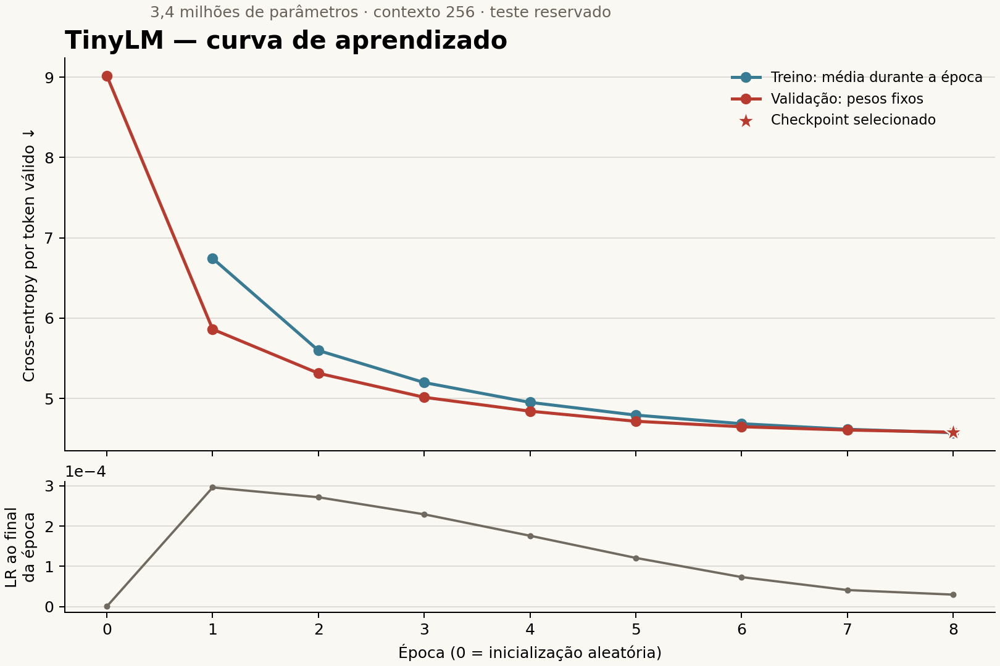

# TinyLM — treinamento 1.0.0

Concluído em 01/11/2026: 8 épocas na RTX 5050 Laptop GPU, com bfloat16,
3.401.856 parâmetros e contexto de 256 tokens. Foram 7.816 atualizações,
sem passos pulados por erro numérico.

| Indicador | Valor |
| --- | ---: |
| Loss inicial de validação | 9,017028 |
| Melhor loss de validação | **4,579009** |
| Época selecionada | **8** |
| Última loss de treino online | 4,572883 |
| Loss de validação após recarregar o checkpoint | 4,579009 |
| Duração do loop, excluindo preparação/testes/gráfico | 183,7 s |
| Ocorrências de alvos vistas nas oito épocas | 23.629.736 |
| Avaliação no teste reservado | Não executada |

AdamW: LR máxima 0,0003; weight decay 0,1 nas matrizes; dropout 0,1;
warmup de 390 atualizações e cosine decay até 0,00003; clipping 1,0;
parada antecipada com paciência 3 e min_delta 0,005.

Melhor/último checkpoint: `private/epoch_0008.pt`. O índice contém hashes,
e `load_trained_model()` carrega os pesos selecionados. Nove checkpoints
locais, incluindo a inicialização, ocupam aproximadamente 325 MiB.

Treino mede pesos em atualização com dropout; validação mede pesos fixos
sem dropout. A melhora de loss não equivale a accuracy nem certifica a
qualidade de respostas do Coach. Geração e teste ficam para a 7.03.5.

Dados congelados: corpus `1.2.0`, BPE `1.0.0`, dados preparados `1.0.0`.
Não foram acrescentados textos, redivididas partições ou alterados os
modelos NLP. As métricas completas estão em `history.json`/`history.csv`;
o vínculo dos dados e códigos está em `binding.json`.
