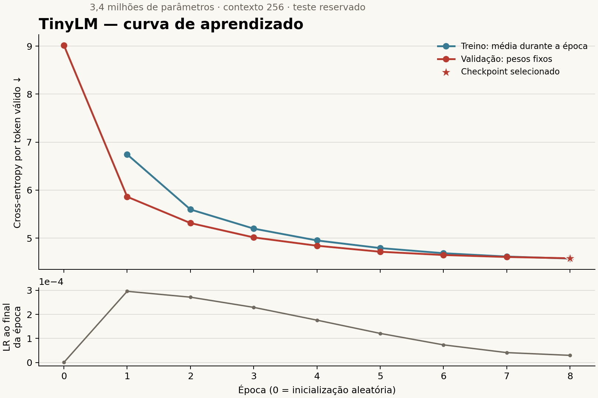

# 7.03.4 — Treinamento, regularização e checkpoints

Concluído em 01/11/2026. O TinyLM `1.0.0` de 3.401.856 parâmetros foi treinado
do zero na RTX 5050 Laptop GPU. A rodada usou os dados preparados `1.0.0`,
o corpus `1.2.0` e o BPE `1.0.0`, sem modificar esses artefatos.

## Resultado real

| Época | Loss de treino durante a época | Loss de validação |
| --- | ---: | ---: |
| 0 — pesos aleatórios | — | 9,0170 |
| 1 | 6,7432 | 5,8608 |
| 2 | 5,5963 | 5,3127 |
| 3 | 5,1969 | 5,0135 |
| 4 | 4,9503 | 4,8404 |
| 5 | 4,7917 | 4,7150 |
| 6 | 4,6845 | 4,6468 |
| 7 | 4,6149 | 4,6056 |
| 8 — selecionada | 4,5729 | **4,5790** |

Foram executadas oito épocas completas, 7.816 atualizações do otimizador e
nenhuma atualização foi pulada por instabilidade numérica. O loop registrado
durou aproximadamente 184 segundos, sem incluir instalação, testes e gráfico.
O melhor checkpoint foi recarregado e reproduziu a loss de validação
`4.57900928032935`.

**Loss é o erro médio de previsão do próximo token; menor é melhor.** Não é
porcentagem de acertos. `4,58` não equivale a `45,8%`, e não é comparável ao
F1/accuracy dos classificadores de intenção e risco.

A curva desceu continuamente na validação nessa rodada. Isso demonstra melhora
nesse recorte reservado para desenvolvimento. Ainda não determina a qualidade
dos textos gerados ou a confiabilidade do Coach. A avaliação final no teste e
a análise das gerações pertencem à 7.03.5.



A loss de treino é medida com dropout ativo e pesos que mudam entre os lotes.
A validação usa `eval()`, sem dropout, com os pesos fixos ao final da época.
As curvas não são uma comparação perfeitamente controlada de generalização;
a validação ser menor que o treino nas primeiras épocas é compatível com
essas diferenças. Não se conclui ausência de overfitting apenas por isso.

## A sequência agora

```text
train_tinylm.py
 → carrega configuração do modelo e do treino
 → confere os dados preparados e a compatibilidade do vocabulário
 → monta os loaders de TREINO e VALIDAÇÃO
 → inicializa TinyLM + AdamW + scheduler
 → mede validação inicial e salva checkpoint 0
 → repete por época:
      model.train()
      lote → forward → loss → backward → clipping → optimizer.step()
      scheduler.step()
      model.eval() → loss de validação sem gradientes
      registra métricas → salva checkpoint → decide se continua
 → recarrega o checkpoint de menor loss de validação
 → verifica a loss recarregada e registra o resultado
```

O otimizador é quem atualiza os pesos depois de `backward()`. Não há `fit()`
nessa implementação: o loop está explícito em `training.py`.
Os alvos já chegam deslocados pela fase anterior. O treinador usa a loss
da rede diretamente, sem deslocar novamente ou usar os textos de teste.

## Configuração aplicada

| Técnica | Configuração | Para que serve |
| --- | --- | --- |
| AdamW | LR máxima `0.0003`, betas `0.9/0.95`, epsilon `1e-8` | Atualizar os pesos usando o histórico dos gradientes |
| Weight decay | `0.1` nas matrizes; zero em biases e LayerNorm | Regularizar o crescimento dos pesos |
| Dropout | `0.1`, já presente no modelo | Reduzir dependência de ativações específicas durante o treino |
| Warmup | Primeiros 5% das atualizações planejadas: 390 | Aumentar a LR gradualmente no início |
| Cosine decay | Redução até `0.00003` | Diminuir os passos conforme o treino avança |
| Gradient clipping | Norma máxima `1.0` | Limitar gradientes excessivos antes da atualização |
| Precisão mista | bfloat16 na GPU; loss em precisão apropriada via autocast | Reduzir custo de memória e cálculo |
| Parada antecipada | Paciência de 3 épocas, melhora significativa de `0.005` | Interromper quando a validação para de progredir |
| Checkpoints | Inicial e após cada época completa | Preservar pesos e estado necessários para retomada |

O peso compartilhado entre embedding e saída entra uma única vez no AdamW.
O campo de norma dos gradientes no histórico é medido **antes** do clipping;
por isso pode ser maior que 1. O limite é aplicado antes do passo do otimizador.

Em precisão `auto`, o treinador escolhe bfloat16 quando a GPU suporta, float16
em outras GPUs CUDA e float32 na CPU. O caminho float16 usa GradScaler;
atualizações puladas por overflow não avançam o scheduler. Nesta rodada com
bfloat16 não houve passos pulados. O código falha explicitamente em loss
ou gradientes não finitos fora desse mecanismo de controle.

A seleção do melhor checkpoint considera qualquer menor loss de validação.
O `min_delta` controla a paciência da parada antecipada, não impede guardar
uma melhora pequena. Nesta rodada a validação continuou melhorando e o
treino terminou ao completar as oito épocas planejadas.

## Dados usados e teste reservado

Em cada época foram usados todos os **2.953.717 alvos de treino** e os
**21.588 alvos de validação**, incluindo os finais de documentos e lotes.
A contagem é conferida pelo código a cada época, com padding ignorado.
Somar as oito passagens dá 23.629.736 ocorrências de alvos de treino vistas;
isso **não aumenta o corpus**: são oito passagens pelo mesmo material.

Não foi calculada loss, perplexidade ou qualidade de geração no teste nesta
fase. A rotina de integridade dos dados confere os arquivos das partições,
incluindo o teste, sem usar seus resultados para treinar ou selecionar pesos.
Nenhum texto real novo, resposta de fórum ou rótulo foi acrescentado.

A loss de cada época é `soma dos erros / total de alvos válidos`. Fazer uma
média simples das médias dos lotes daria peso incorreto aos lotes com mais
padding ou menos sequências. A validação usa `no_grad()` e restaura o modo
anterior da rede depois de terminar.

## Organização dos arquivos

```text
ai/configs/tinylm.v1.json
  → arquitetura já pronta, preservada

ai/configs/tinylm.training.v1.json
  → épocas, LR, regularização, precisão, semente e parada antecipada

ai/src/evolv_tinylm/training.py
  → build_optimizer(): separa matrizes de biases/normalizações
  → lr_factor(): warmup e decaimento cossenoidal
  → evaluate_loss(): loss ponderada pelos alvos válidos
  → train(): loop de treino e validação
  → read_checkpoint(): valida e lê best/last
  → load_trained_model(): reconstrói a rede treinada em eval()

ai/scripts/train_tinylm.py
  → comando para começar ou retomar

ai/scripts/plot_tinylm_training.py
  → exporta PNG e SVG usando as métricas registradas

ai/artifacts/tinylm_training/1.0.0/
  → model_config.json, training_config.json: configurações da rodada
  → binding.json: versões, hashes e ambiente de execução
  → history.json e history.csv: métricas de cada época
  → progress.json: situação atual ou final
  → results.json: resultado e checkpoint selecionado
  → checkpoint_index.json: ponteiros best/last e hashes
  → loss_curve.png e loss_curve.svg: gráfico exportado
  → manifest.json: integridade dos resultados e gráficos
  → private/epoch_0000.pt ... epoch_0008.pt: checkpoints locais
```

Os nove checkpoints ocupam aproximadamente **325 MiB** no total e ficam
ignorados pelo Git. Cada arquivo tem modelo, AdamW, scheduler, scaler,
época, histórico, contadores e estados aleatórios. O checkpoint 0 tem os
pesos aleatórios iniciais. `best` e `last` apontam para `epoch_0008.pt`
nesta rodada, mas podem apontar para épocas diferentes em outro treinamento.
As obrigações de licença, atribuição e privacidade do corpus continuam valendo.

## Retomada e carregamento

Um checkpoint só é publicado no índice depois que seu arquivo completo foi
salvo em uma substituição atômica. O nome é próprio para cada época, de modo
que uma gravação interrompida não substitui o último checkpoint publicado.
Os hashes são conferidos antes de carregar com `weights_only=True`.

A retomada volta à **última época completa**. Uma parte interrompida de uma
época será refeita. O histórico é reconstruído a partir do checkpoint
confirmado. A configuração, os dados, o código principal e o runtime precisam
corresponder aos registrados; alterar o plano exige outra rodada/pasta.
Uma rodada já concluída fica protegida contra uma continuação acidental.

O checkpoint preserva RNG de Python, NumPy, PyTorch, CUDA e dos loaders.
Nos testes, interromper após a primeira época e retomar reproduziu exatamente
pesos e histórico de uma execução contínua na CPU com dropout. A identidade
bit a bit entre kernels, GPUs ou ambientes diferentes não é garantida.

Exemplo para a próxima fase, com `ai/src` disponível no caminho de módulos:

```python
from evolv_tinylm.training import load_trained_model

model, info = load_trained_model("ai/artifacts/tinylm_training/1.0.0", device="cpu")
# model está em eval(), com os pesos do melhor checkpoint.
# info contém a época, a loss registrada e o vínculo com os dados/tokenizador.
```

Na raiz do repositório, usando o Python 3.12 do ambiente de pesquisa:

```powershell
# Nova rodada com o plano atual, em outra pasta:
python ai/scripts/train_tinylm.py --device cuda --output ai/artifacts/tinylm_training/experimento-novo

# Retomar uma rodada interrompida, com o mesmo plano:
python ai/scripts/train_tinylm.py --device cuda --output ai/artifacts/tinylm_training/experimento-novo --resume

# Conferir todos os testes do TinyLM:
python -m unittest discover -s ai/tests -p "test_tinylm*.py" -v

# Recriar o gráfico, sem carregar pesos:
python -m pip install -r ai/requirements.tinylm-plots.txt
python ai/scripts/plot_tinylm_training.py
```

O ambiente usado nesta entrega está em
`C:\Users\ganto\Documents\Codex\2026-09-09\to\.venv-evolv-review\Scripts\python.exe`.
Se `python` no terminal apontar para outro ambiente, use esse executável ou
ative o ambiente correto. O Python 3.14 usado na suíte geral não tem PyTorch.

## Verificação e próximos limites

Os **41 testes das fases TinyLM passaram** no Python 3.12, incluindo oito
testes desta entrega. Eles conferem separação dos grupos do AdamW, schedule,
ponderação por tokens, seleção do melhor checkpoint, retomada, falhas de
integridade e o carregamento dos pesos reais na CPU.
Os checkpoints reais foram conferidos pelos hashes e o melhor foi recarregado
para repetir a validação. O corpus, o BPE e os dados preparados foram preservados.
A suíte geral em Python 3.14 executou 265 testes: 238 passaram e 27 foram
ignorados por condições do ambiente. Os testes de treino que exigem PyTorch
passaram separadamente no ambiente Python 3.12 usado na rodada real.

O resultado é de um **pequeno modelo de linguagem treinado**, ainda sem ajuste
de instruções para se comportar como Coach. O corpus continua predominantemente
enciclopédico e as avaliações são pequenas. A próxima fase deve mostrar textos
gerados, erros, limites e as métricas no teste reservado. Isso determinará o
que ele de fato aprendeu a produzir. Os classificadores de intenção e risco,
o extrator e o futuro Coach principal pré-treinado continuam separados.

Próxima: **7.03.5 — geração de texto e avaliação final**.

Referências técnicas: [AdamW](https://docs.pytorch.org/docs/2.11/generated/torch.optim.AdamW.html),
[precisão mista](https://docs.pytorch.org/docs/2.11/amp.html),
[LambdaLR](https://docs.pytorch.org/docs/2.11/generated/torch.optim.lr_scheduler.LambdaLR.html) e
[serialização de estados no PyTorch](https://docs.pytorch.org/docs/2.11/notes/serialization.html).
