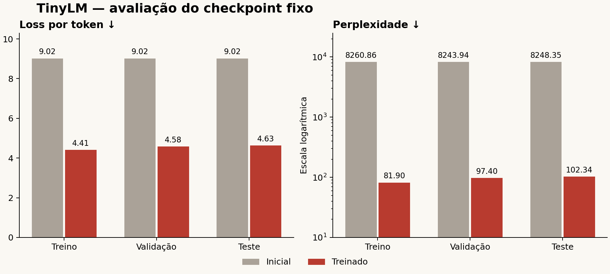

# 7.03.5 — Geração e avaliação final do TinyLM

Concluído em 01/11/2026. O checkpoint da época 8 foi avaliado sem atualização
de pesos e comparado com o checkpoint inicial da mesma rodada. O protocolo,
os prompts e as estratégias foram fixados antes de calcular a loss no teste.
Corpus, tokenizador, dados preparados e checkpoints permanecem inalterados.

## Resultado principal

Janelas de documento de até 256 tokens, as mesmas da preparação/treinamento,
sem misturar documentos. Todos os alvos válidos são contados uma vez.

| Partição | Documentos | Alvos | Loss inicial | Loss treinada | PPL inicial | PPL treinada |
| --- | ---: | ---: | ---: | ---: | ---: | ---: |
| Treino | 6.612 | 2.953.717 | 9,0193 | 4,4055 | 8.260,86 | 81,90 |
| Validação | 57 | 21.588 | 9,0172 | 4,5789 | 8.243,94 | 97,40 |
| Teste | 42 | 14.880 | 9,0178 | **4,6283** | 8.248,35 | **102,34** |

O treinamento melhorou a previsão de tokens em dados separados do treino.
As gerações, porém, continuam fracas em coerência e relevância. A fase TinyLM
está implementada e avaliada como experimento didático; a qualidade observada
ainda é insuficiente para usá-lo como Coach de conversa.



## O que significam as métricas

**Loss** é o erro médio de previsão do próximo token, ponderado pelo número
de alvos válidos. **Perplexidade = exp(loss)**. Menor é melhor dentro do mesmo
tokenizador e protocolo; não é porcentagem de acertos nem uma medida de
veracidade. Não se compara diretamente PPL de modelos que usam vocabulários,
corpora ou métodos de contexto diferentes.

O teste também teve acerto top-1 de próximo token de aproximadamente 22,24%,
contra 1,76% nos pesos iniciais. Aqui se escolhe entre 8.192 tokens possíveis,
posição por posição. Essa accuracy não é a accuracy de intenção, risco ou
resposta correta a uma pergunta.

Todas as medidas usam os logits originais em float32: temperatura, top-k,
top-p e bloqueio de tokens da geração não entram no cálculo da loss/PPL.
EOS é um alvo; BOS e padding não são. A loss de treino desta avaliação usa
pesos fixos e dropout desativado, por isso difere da loss online da época 8.
As pequenas diferenças da validação em relação à 7.03.4 também refletem
float32 aqui e autocast bfloat16 durante o treinamento.

Na avaliação, o modelo recebe o **prefixo correto do texto** para prever
o próximo token. Na geração, ele passa a consumir suas próprias escolhas,
e desvios podem se acumular. Melhorar loss/PPL nesse exercício não garante
uma continuação longa coerente ou uma boa conversa.

## Método adicional: contexto sobreposto

Foi fixada uma segunda medida, com contexto 256 e stride 128, para validação
e teste. Ela reaproveita contexto anterior e ignora os alvos já avaliados.
Não junta documentos nem conta alvos duplicados.

| Partição | Loss treinada | PPL treinada | Alvos |
| --- | ---: | ---: | ---: |
| Validação | 4,5665 | 96,21 | 21.588 |
| Teste | 4,6107 | 100,55 | 14.880 |

O resultado principal permanece o das janelas da 7.03.2. A medida sobreposta
é identificada separadamente: mudar a quantidade de contexto muda a PPL.
Nenhuma das medidas foi usada para retreinar ou escolher outro checkpoint.

## Como a geração funciona

```text
prompt escrito
 → BPE congelado: [BOS] + tokens do prompt, sem EOS no fim do prompt
 → últimos até 256 tokens entram no TinyLM em eval()
 → scores do próximo token
 → escolhe um token por greedy ou amostragem
 → acrescenta esse token ao contexto
 → repete até EOS ou até o limite de tokens novos
 → decodifica a continuação
```

O ciclo usa `inference_mode()`, sem gradientes ou otimizador. Cada amostra
tem um gerador aleatório local com semente, sem mudar o RNG global. O modo
anterior do modelo é restaurado depois. Repetibilidade foi verificada na GPU
do ambiente registrado; não se promete igualdade entre versões/dispositivos.

PAD, BOS, UNK e tokens reservados de papéis são bloqueados na saída. EOS
continua permitido e encerra a amostra imediatamente. Não há penalidade de
repetição ou proibição de n-gramas nesta versão, para observar os problemas
do modelo sem esconder loops.

Se o contexto exceder 256 tokens, a geração usa a janela mais recente e
informa quantos tokens do prompt ficaram fora da primeira janela e quantos
passos precisaram desse recorte. O prompt integral continua no registro.
Não há cache de chaves/valores nesta implementação; o prefixo é recalculado.

## Estratégias e resultados das 128 amostras

Foram usados oito prompts próprios, abrangendo continuação enciclopédica,
cotidiano, treino, alimentação, pergunta, agenda, desconforto e disponibilidade.
Cada amostra teve até 64 tokens novos. As estratégias aleatórias tiveram
três sementes: 42, 123 e 2026. Greedy foi executado uma vez por prompt.

| Estratégia | Como escolhe | Amostras | Repetição média de bigramas |
| --- | --- | ---: | ---: |
| Greedy | Maior score a cada passo | 8 | 68,0% |
| Sampling T=0,7 | Distribuição mais concentrada | 24 | 4,0% |
| Sampling T=1,0 | Distribuição original | 24 | 0,2% |
| Sampling T=1,3 | Distribuição mais dispersa | 24 | 0,0% |
| Top-k=50, T=1,0 | Sorteia entre até 50 candidatos | 24 | 0,6% |
| Top-p=0,9, T=1,0 | Menor prefixo de candidatos que acumula massa de pelo menos 0,9 | 24 | 0,2% |

As três temperaturas mantêm os outros filtros desligados, permitindo observar
a mudança de temperatura sem alterar top-k/top-p ao mesmo tempo. Top-k e
top-p são comparados com sampling T=1. A implementação também permite combinar
os dois filtros, mas essa combinação não faz parte da grade desta avaliação.

Repetição é uma estatística dos pares de palavras da continuação. Não é uma
nota de linguagem: sequências sem sentido também podem ter repetição zero.
As quantidades de amostras e a duração das continuações diferem entre modos.
Não se escolheu uma configuração de produção por essa pequena comparação.

Greedy atingiu o limite em sete de oito amostras. Temperatura 1,3 produziu
três caracteres Unicode de substituição no conjunto de 24 amostras; os outros
modos não apresentaram esse caractere. Isso pode ocorrer por sequências de
bytes geradas inválidas ou pelo encerramento no meio de um caractere. Não
significa falha de recuperação dos textos originais pelo BPE da 7.03.1.

## Erros observados

A leitura qualitativa cobriu integralmente **24 amostras predefinidas**:
todos os oito prompts em greedy, sampling T=1 e top-p=0,9, semente 42.
Foi uma revisão por IA, não por avaliadores humanos independentes, com
critérios registrados em `qualitative_review.json`.

- Loops de expressões e datas, especialmente em greedy.
- Palavras deformadas e falhas de concordância.
- Mudança para assuntos sem relação com o prompt.
- Aparência de verbete, referência, lista ou data sem verificação factual.
- Falha em responder aos pedidos de exercício, agenda e disponibilidade.
- Falha em produzir uma resposta útil ao prompt de desconforto. O experimento
  não demonstra orientação clínica segura ou capacidade de tratar lesões.

Nenhuma das 24 continuações sustentou uma ideia coerente no critério adotado.
As 12 amostras referentes a perguntas e pedidos de conversa não deram uma
resposta útil ao pedido. Isso descreve as amostras revisadas, não uma taxa
populacional medida com avaliadores independentes.

No teste de previsão de token, os maiores erros incluem partes de palavras,
nomes e trechos técnicos. Foram guardados os 20 erros de maior NLL em
validação e no teste, sempre com previsão diferente do alvo. Os registros
incluem prefixo, IDs do alvo/predição, cinco candidatos e atribuição/licença.
Um token isolado pode ser parte de um caractere; o texto decodificado de um
token sozinho não deve ser interpretado sempre como uma palavra completa.

O teste é pequeno e 97,5% dos seus alvos vêm da Wikipedia. Há apenas quatro
documentos OASST e cinco textos NLU nessa partição. Os resultados não medem
adequadamente conversas reais extensas ou todas as funções do Evolv.
O tamanho do modelo, a composição do corpus e a ausência de ajuste instrucional
são limitações conhecidas; esta fase não isolou suas contribuições por ablação.

## Organização dos arquivos

```text
ai/configs/tinylm.evaluation.v1.json
  → checkpoint fixo, métodos de avaliação, prompts, sementes e filtros

ai/src/evolv_tinylm/generation.py
  → GenerationConfig: limites e opções
  → filter_logits(): top-k e top-p
  → generate(): ciclo autoregressivo, EOS, contexto e RNG local
  → text_diagnostics(): repetição, extensão e caracteres de substituição

ai/src/evolv_tinylm/lm_evaluation.py
  → evaluate_partition(): NLL, PPL, acerto de token, fontes e documentos
  → StridedEvaluationDataset: contexto sobreposto sem repetir alvos
  → evaluate_release(): congela seleção, avalia e gera a grade completa

ai/scripts/generate_tinylm.py
  → usa o modelo treinado para uma continuação
ai/scripts/evaluate_tinylm.py
  → executa o protocolo fixo em uma pasta nova
ai/scripts/report_tinylm_evaluation.py
  → produz relatório e gráfico das medidas já registradas

ai/artifacts/tinylm_evaluation/1.0.0/
  → protocol.json e frozen_selection.json: decisões anteriores à avaliação
  → metrics.json: medidas dos dois checkpoints e dois métodos
  → generation_summary.json: diagnósticos por estratégia
  → qualitative_review.json: análise por IA das 24 amostras fixas
  → evaluation.json: versão, vínculo dos dados e estado final
  → RESULTS.md: relatório de resultados
  → evaluation_metrics.png/.svg: gráfico exportado
  → manifest.json e report_manifest.json: hashes de arquivos/códigos
  → private/generations.jsonl: todas as 128 saídas integrais
  → private/qualitative_review_samples.jsonl: as 24 amostras lidas
  → private/{initial,trained}_{split}_documents.jsonl: erros por documento
  → private/{validation,test}_token_errors.jsonl: 20 maiores erros por partição
```

Detalhes de documentos, contextos e gerações integrais ficam em `private/`,
ignorados pelo Git. As atribuições e licenças do corpus continuam relevantes.
As saídas são texto experimental e não executam mudanças no Planner ou no app.

## Uso

Na raiz do repositório, com o Python 3.12 do ambiente de pesquisa:

```powershell
python ai/scripts/generate_tinylm.py "Uma rotina de exercícios pode" --temperature 0.7 --top-p 0.9
python ai/scripts/generate_tinylm.py "Hoje acordei cedo e" --greedy
python ai/scripts/generate_tinylm.py "O Brasil é um país" --temperature 1.0 --top-k 50 --top-p 1.0
python -m unittest discover -s ai/tests -p "test_tinylm*.py" -v
python ai/scripts/report_tinylm_evaluation.py
```

O comando de geração aceita `--max-new-tokens`, `--seed`, `--device`,
`--temperature`, `--top-k`, `--top-p` e `--greedy`. Em greedy os filtros e
a temperatura não mudam a escolha do maior score. A temperatura deve ser
positiva; use `--greedy` para tirar o sorteio.

A pasta padrão da avaliação está pronta e protegida contra sobrescrita.
O protocolo agora tem resultados de teste conhecidos: futuras alterações
de modelo/dados devem ser desenvolvidas com treino/validação e registradas
como novas experiências. Não se deve usar o teste para escolher parâmetros
e depois apresentá-lo como avaliação cega independente.

## Fechamento da 7.03

As cinco partes foram implementadas: BPE próprio, dados de próximo token,
Transformer causal, treinamento e avaliação/geração. Os **52 testes TinyLM
passaram** no ambiente com PyTorch, incluindo contagem exata dos alvos em
ambos os métodos e reprodução de uma geração real na GPU.
A suíte geral com Python 3.14 executou 276 testes: 239 passaram e 37 foram
ignorados por condições do ambiente. Os testes que exigem PyTorch foram
executados no Python 3.12 do treinamento e da avaliação. O comando de geração
também foi conferido diretamente no terminal com um prompt próprio.

A implementação funciona e a loss melhorou, mas a geração observada segue
fraca. O Coach principal planejado, baseado em modelo pré-treinado com
adaptação e os demais componentes do app, continua sendo outra etapa.

Referências técnicas: [PPL e contexto limitado](https://huggingface.co/docs/transformers/perplexity),
[estratégias de geração](https://huggingface.co/blog/how-to-generate),
[torch.multinomial](https://docs.pytorch.org/docs/2.11/generated/torch.multinomial.html) e
[torch.topk](https://docs.pytorch.org/docs/2.11/generated/torch.topk.html).
